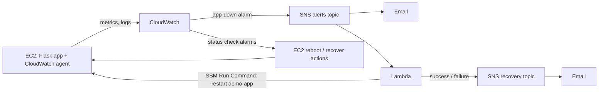

# AWS Self-Healing Infrastructure

An EC2-hosted Flask app that detects failures and recovers on its own.
Built with Terraform, CloudWatch, SNS, Lambda and Systems Manager (SSM).

## Architecture



## What it recovers from

| Failure | Detection | Response |
|---|---|---|
| App process crashes | `procstat_lookup_pid_count` alarm | Lambda restarts `demo-app` via SSM |
| High CPU | `cpu_usage_idle` alarm | Email only |
| OS hang | `StatusCheckFailed_Instance` | EC2 reboot |
| Host failure | `StatusCheckFailed_System` | EC2 auto-recover |
| Instance replaced | n/a | User data rebuilds the app and agent |

## Repository layout

- `terraform/`: all infrastructure (EC2, IAM, alarms, SNS, Lambda)
- `app/`: Flask app and systemd unit
- `monitoring/`: CloudWatch agent config
- `lambda/`: recovery function

## Deploy

```powershell
cd terraform
# create terraform.tfvars with: alert_email = "you@example.com"
terraform init
terraform plan -out=tfplan
terraform apply tfplan
```

Confirm both SNS subscription emails after the first apply.

## Test the recovery

```powershell
aws ssm send-command --instance-ids <instance-id> --document-name AWS-RunShellScript `
  --parameters 'commands=["systemctl stop demo-app"]' --region ap-south-1
```

Within about 5 minutes the alarm fires, the Lambda restarts the app,
and you get a "Recovery SUCCEEDED" email.

## What I learned

- - **Alarms need the exact metric dimensions.** The CloudWatch agent publishes the
  process-count metric with extra dimensions (`pattern`, `pid_finder`). I checked
  them with `list-metrics` before building the alarm, because a mismatch leaves it
  stuck in `INSUFFICIENT_DATA`.
- **First-boot IAM race.** The SSM agent started before the instance profile
  credentials were available, so the instance never registered. I fixed it with
  `depends_on` on the policy attachments and an SSM agent restart at the end of
  user data.
- **Avoiding an SNS-to-Lambda loop.** The Lambda is subscribed to the alerts topic,
  so it publishes recovery results to a separate topic. Publishing to its own
  trigger would invoke it endlessly.
- **Windows line endings broke systemd.** Files written on Windows contain `\r`,
  which makes unit-file lines invalid on Linux. The user-data script strips them
  with `tr -d '\r'`.
- **Missing data should count as a failure.** The app-down alarm uses
  `treat_missing_data = "breaching"`, so a dead agent or dead instance also fires it,
  not only a crashed process.
- **Least privilege.** The Lambda role can only send commands to this one instance
  with one SSM document, and publish to one topic.
- **Reference resources instead of hardcoding IDs.** The alarms and Lambda use
  `aws_instance.app_server.id`, so replacing the instance rewired everything
  automatically and the recovery chain worked on the rebuilt server with no manual
  changes.

## Limitations

- Single instance. An Auto Scaling group would replace a lost instance automatically.
- The Flask development server is used for the demo, not a production WSGI server.
