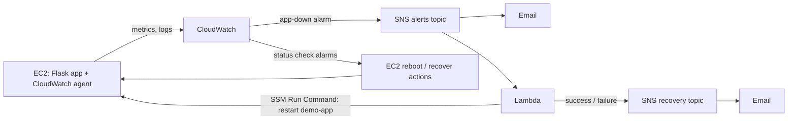

# AWS Self-Healing Infrastructure

An EC2-hosted Flask app that detects failures and recovers on its own.
Built with Terraform, CloudWatch, SNS, Lambda and Systems Manager (SSM).

## Architecture



## What it recovers from

| Failure | Detection | Response |
|---|---|---|
| App process crashes | `procstat_lookup_pid_count` alarm | Lambda restarts `demo-app` via SSM |
| High CPU | `cpu_usage_idle` alarm | Email only |
| OS hang | `StatusCheckFailed_Instance` | EC2 reboot |
| Host failure | `StatusCheckFailed_System` | EC2 auto-recover |
| Instance replaced | n/a | User data rebuilds the app and agent |

## Repository layout

- `terraform/`: all infrastructure (EC2, IAM, alarms, SNS, Lambda)
- `app/`: Flask app and systemd unit
- `monitoring/`: CloudWatch agent config
- `lambda/`: recovery function

## Deploy

```powershell
cd terraform
# create terraform.tfvars with: alert_email = "you@example.com"
terraform init
terraform plan -out=tfplan
terraform apply tfplan
```

Confirm both SNS subscription emails after the first apply.

## Test the recovery

```powershell
aws ssm send-command --instance-ids <instance-id> --document-name AWS-RunShellScript `
  --parameters 'commands=["systemctl stop demo-app"]' --region ap-south-1
```

Within about 5 minutes the alarm fires, the Lambda restarts the app,
and you get a "Recovery SUCCEEDED" email.

## What I learned

- [Add 2 or 3 real points, for example the SSM first-boot credential race,
  CloudWatch alarms needing exact metric dimensions, and avoiding an SNS-to-Lambda loop.]

## Limitations

- Single instance. An Auto Scaling group would replace a lost instance automatically.
- The Flask development server is used for the demo, not a production WSGI server.